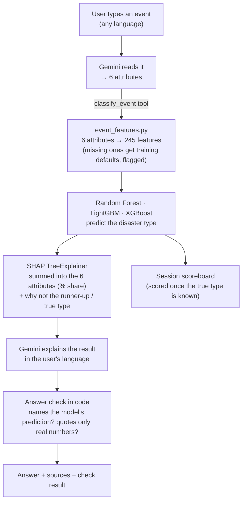

# Disaster Type Prediction & Interactive Model Auditor (Explainable AI)

A Senior Project that integrates **Multi-class Disaster Event Classification (Random Forest, LightGBM, and XGBoost pipelines)** with an **Agentic Model Auditor** and **Explainable AI (SHAP)**.

---

## 🌟 Key Features

1. **High Performance ML Pipeline**:
   - Random Forest, LightGBM, and XGBoost classifiers, each in a **SMOTETomek** class-balancing pipeline.
   - Random Forest: **91.70% Test Accuracy** and **0.8518 F1-Macro** across 8 disaster categories; the leaderboard tab shows all three models with bootstrap 95% CIs and McNemar significance tests.
2. **Interactive Ground Truth Model Auditor**:
   - Challenges the pre-trained model with 3,495 real historical events from the EM-DAT test set.
   - Live side-by-side comparison: **Model Prediction vs. Ground Truth**, or all three models at once in Compare mode.
   - Model Disagreement Radar surfaces the test cases where the three models predict different classes.
   - Real-time Session Scoreboard: Accuracy and Macro-F1 of the **ML model** per source: test-bank cases (recorded features), **Typed tests** (a test case rewritten by Gemini as a message without its type, then read back and classified, so it's scored against the real answer automatically, along with how many of the 6 attributes the LLM read correctly) and events users describe.
   - **Describe your own event** in the chat (Thai or English), e.g. "a storm hit southern Thailand in November, 120 km/h winds, 3 days": Gemini extracts the 6 attributes, the models predict, and once you confirm what it really was, it's scored.
   - **Model inputs:** 245 features built from 6 pre-event attributes (country, magnitude scale, region, start month, event duration, magnitude value); the Leaderboard tab lists them. `src/event_features.py` encodes a described event exactly like the training data.
3. **Explainable AI (SHAP TreeExplainer)**:
   - Quantifies the impact of physical features (magnitude scale, event duration, timing, geographic region).
   - Explains *why* the model made each decision, both for correct cases and hard misclassified cases.
4. **LLM Auditor Chat (Claude or Gemini)**:
   - **Agent mode (Gemini or Claude):** the LLM calls the app's tools itself (find a test case, classify an event you describe, explain a prediction with SHAP, read metrics, McNemar tests and per-class errors) and answers from their results; each step is listed under the answer. Gemini uses function calling on the free tier; turn agent mode off in Settings for a fixed route-then-answer flow that uses fewer calls.
   - **Asks before guessing:** if a described event lacks the place, what was measured, or both the month and the duration, `classify_event` returns a question instead of running the models (decided in code, asked once). "Nothing was measured" is taken as a real answer, since every recorded Landslide and half the Epidemics have no measurement; "I don't know" runs the models with flagged defaults.
   - SHAP is summed back into the 6 attributes as % of the evidence (comparable across models), attributes you didn't give are flagged as defaults, and every prediction comes with "why not X?" (the true type when the model was wrong, otherwise the runner-up).
   - **Any language:** ask in Thai, English, Japanese, French, Chinese, Spanish and more; the reply follows the language of your latest message (decided in code each turn, so earlier turns don't pull it into another language), with class names also given in English, e.g. 地震 (Earthquake). The models only see the 6 attributes, so no retraining is needed for a new language.
   - Ask questions about the active case; answers are grounded in its predictions and SHAP drivers. Each answer notes its sources (benchmark figures, the case on screen, and Gemini's general knowledge where it says so).
   - **The ML models make every prediction; the LLM only reads the message and explains the result.** Each case answer is checked in code (no extra LLM call) against the model output: it must name the model's prediction and quote only percentages the model or the benchmarks produced, shown as "Explanation matches the model's output" or a warning.
   - Optional **LLM baseline** (Settings, off by default): Gemini also guesses the type itself from the same 6 attributes, scored beside the model for comparison.
   - Choose Anthropic Claude or Google Gemini in the sidebar and paste an API key, or save it once in `.streamlit/secrets.toml` (git-ignored) as `GEMINI_API_KEY` / `ANTHROPIC_API_KEY` so it loads on every start. Environment variables and a `.env` file work too; `LLM_PROVIDER = "gemini"` or `"claude"` picks the starting provider.
   - Falls back to a **Local Auditor Engine** summary when no API key is provided.

---

## 🔄 How It Works

The LLM is the interface and the ML models are the engine: Gemini reads the message and explains the result, but never makes the prediction itself.



- **SHAP runs on every prediction**, right after the models. Gemini only sees the SHAP shares the code computed; it doesn't invent the reasons.
- **Test-bank cases** skip the first two steps: their 245 features are already recorded.
- **Typed tests** run the whole chain on a test case Gemini rewrote as a message, so the scoreboard and `reports/typed_eval/` measure the full typed path against a known answer.
- Without an API key, or once the shared key's quota is used up, the models and SHAP still run and a built-in summary replaces Gemini's answer.

---

## 📂 Project Structure

```text
disaster-type-prediction/
├── app.py                      # Streamlit app: chat, case cards, scoreboard, benchmarks, quota guard
├── Dockerfile                  # Container definition for reproducible deployment
├── requirements.txt            # Python dependencies (requirements-dev.txt adds pytest)
├── .streamlit/config.toml      # Streamlit theme & server settings (secrets.toml is git-ignored)
├── models/                     # Production artifacts
│   ├── rf_pipeline.joblib      # Trained best Random Forest Pipeline
│   ├── lgb_pipeline.joblib     # LightGBM Pipeline
│   ├── xgb_pipeline.joblib     # XGBoost Pipeline
│   ├── multi_model_bank.joblib # 3,495 test events with precomputed predictions from all 3 models
│   ├── multi_model_metadata.json # Feature names, leaderboard, McNemar results
│   ├── metadata.json           # (legacy, single-model) feature names and metrics
│   └── ground_truth_bank.json  # (legacy, single-model) test events with ground truth
├── src/                        # Modular production code
│   ├── models/                 # Multi-model layer used by the app
│   │   ├── registry.py         # Loads the case bank, runs audits, "why not X?" contrasts
│   │   ├── base.py             # Common model interface; packages SHAP per attribute
│   │   ├── rf_model.py / lgb_model.py / xgb_model.py  # Predict + SHAP per model
│   │   └── utils.py            # Class names & natural-language SHAP explanations
│   ├── event_features.py       # 6 attributes ↔ 245 features, SHAP by attribute, filled-in defaults
│   ├── auditor_agent.py        # Agent tools (classify_event, explain_prediction, metrics…) + Gemini/Claude loops
│   ├── agent.py                # Chat prompts, Gemini client with request counting, reply language, local fallback
│   ├── llm_tasks.py            # Single-shot Gemini tasks: route a message, extract an event, write a typed test
│   ├── answer_check.py         # Checks each answer against the model output (no LLM call)
│   ├── evaluate_typed.py       # Typed-path evaluation → reports/typed_eval/
│   ├── export_all_models.py    # Trains LightGBM/XGBoost, builds multi-model bank & metadata
│   ├── export_model.py         # (legacy) Random Forest pipeline export
│   └── predictor.py / explainer.py / benchmark.py  # (legacy, single-model; not used by app.py)
├── reports/typed_eval/         # Typed-path results (results.jsonl) and report (summary.md, summary.csv)
├── tests/                      # Offline test suite (fake LLM clients, real model bank)
├── notebooks/                  # Academic research & experimental record
│   ├── 01_data_understanding.ipynb
│   ├── 02_data_EDA.ipynb
│   ├── 03_baseline_model.ipynb
│   ├── 04_modeling.ipynb
│   └── 05_model_export_and_benchmark.ipynb
└── data/                       # Datasets
    ├── cleaned/
    └── processed/
```

---

## 🚀 Quickstart & Usage

### 1. Run Locally (Streamlit)

Activate your Python virtual environment and run (to regenerate the LightGBM/XGBoost pipelines and the multi-model bank, first run `python -m src.export_all_models`; it needs `data/processed/disaster_processed_feature_selected.csv`):
```bash
streamlit run app.py
```
Open your browser at `http://localhost:8501`.

### 2. Run with Docker

Build and launch the container with a single command:
```bash
docker build -t disaster-model-auditor .
docker run -p 8501:8501 disaster-model-auditor
```

### 3. Evaluate the typed path (optional, uses ~400 Gemini requests)

Measures how well the system classifies events that people *type*: Gemini rewrites 10 held-out test cases per class as chat messages without their type, the Gemini agent reads each one back and calls the ML models, and the results are compared with the same cases' recorded features. Resumable; the report goes to `reports/typed_eval/summary.md`.
```bash
python -m src.evaluate_typed --per-class 10
python -m src.evaluate_typed --summarize
```

### 4. Run the tests

The suite runs offline (no Anthropic or Gemini calls) in about 15 seconds: the six agent tools against the real model bank, the Claude tool-use loop with a fake client, the Gemini fallback logic, key loading, and every view of the app.
```bash
pip install -r requirements-dev.txt
pytest
```

---

## 🎯 Target Disaster Classes (8 Classes)
1. Drought
2. Earthquake
3. Epidemic
4. Extreme Temperature
5. Flood
6. Landslide
7. Storm
8. Wildfire

---

## ⚠️ Known Limitations & Future Work

- **Typed messages cost little accuracy** (`reports/typed_eval/summary.md`, 80 cases, with the follow-up question): Random Forest 91.2% direct → 88.8% typed, LightGBM 93.8% → 92.5%, XGBoost 90.0% → 87.5%. Gemini reads 97.5% of attributes correctly (magnitude scale 99%); the app asked for more details in 21 of 80 cases. A message that names a measure without a figure ("wind speed was recorded, no number") gives the scale, not "nothing measured": the scale read from the message (`scale_from_text`) wins over the LLM's `nothing_measured` flag. Before that rule, Gemini often passed `nothing_measured` for such messages and typed accuracy fell to 76.2% (Random Forest), with most errors predicted as Landslide (`results_nothing_measured_bug.jsonl`). The remaining misses are country names (e.g. Hong Kong in Thai) and a magnitude written without its unit. Earlier runs: `results_before_follow_up.jsonl` (88.8% / 95.0% / 88.8%) and `results_before_scale_fix.jsonl` (86.2% / 88.8% / 82.5%).
- **Missing attributes are filled with training defaults** (month → January, duration → 0 days) when the user doesn't know them, even after the app asks. The app flags them, but a prediction built mostly from defaults says more about the defaults than the event. In the typed evaluation the user answers the question with "I don't know any other details", so its figures are the worst case for the follow-up.
- **Drought, Flood and Wildfire share the Km2 magnitude scale**, so the models separate them mainly by duration, month and place. This comes from the EM-DAT data, not the code; extra pre-event attributes (rainfall, temperature anomaly) would help.
- **Shared Gemini key on the free tier:** each session gets 40 requests and the app 400 per day, after which built-in summaries replace Gemini's answers. A personal key can be pasted in the sidebar.
